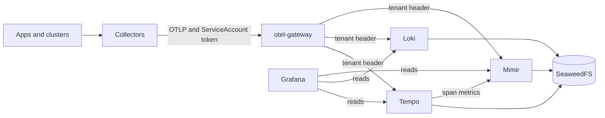
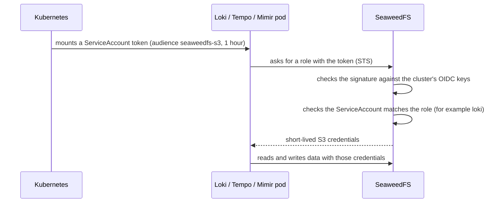

# lgtm-grafana

This chart deploys the Grafana operator, the platform Grafana instance and its Mimir, Loki and Tempo datasources.

New here? Read [TENANCY.md](TENANCY.md) first for the background on multi-tenancy, then [DESIGN.md](DESIGN.md) for what we chose and how it is built.

Think of the stack as **LGTM**:

| Tool | Job in one line | Reachable at |
| --- | --- | --- |
| Loki | Keeps the **logs** | No external address. Written by the gateway, read by Grafana. |
| Grafana | The **screen** you actually look at (the platform Grafana, for platform admins) | `platform.grafana.mgmt.rezakara.demo` |
| Tempo | Keeps the **traces** (who called whom, how slow) | No external address. Written by the gateway, read by Grafana. |
| Mimir | Keeps the **metrics** (numbers over time) | No external address. Written by the gateway (and Tempo's span metrics), read by Grafana. |

Plus **SeaweedFS**, an S3-compatible object store. Loki, Tempo and Mimir keep their data there. It replaced MinIO, which is deprecated.

**Why do we need object storage?**

- **The problem**: Logs, traces and metrics pile up fast, and they have to outlive any single pod. Pods restart and move, and a local disk doesn't follow them. EBS-backed volumes are tied to one availability zone and have to be sized and grown by hand. EFS can be shared across pods, but it is slow and costly for this access pattern.

- **What it gives us**: Cheap, big, shared storage that grows on its own, separate from the pods that use it. Ingestion and querying can scale independently of the storage.

- **Is it mandatory**? For Mimir, effectively yes: its ingesters, store-gateways and compactors are separate pods that need access to the same data blocks. For Loki and Tempo, it's strongly recommended for production rather than strictly required. They can use local filesystem storage for smaller setups, but that limits how far we can scale.

**What goes where.** It is not "hot data on EBS, old data on S3". Each kind of data has its own home:

| Data | Where | Why |
| --- | --- | --- |
| Recent, unflushed data (the ingester's write-ahead log and in-memory head) | Local disk: a volume per ingester pod | Writes must be fast and local. It is small, about the last few hours. |
| Finished blocks, chunks and traces | Object storage | Durable, cheap, shared, and unbounded. |
| Query caches (index headers, chunk and bloom caches) | Local disk or a cache service | Rebuildable from object storage, so losing them only costs speed. |
| Compactor working space | A local volume | Scratch space, also rebuildable. |

Ingesters flush to object storage every couple of hours. Unflushed data is only safe if it is replicated: production uses replication factor 3 across availability zones, while we run 1 locally, so losing an ingester loses its recent data. Retention is set in each compactor, with a bucket lifecycle rule as a backstop.

Everything runs on the **management** cluster, in the `observability` namespace. Other clusters send their data to the gateway at `gateway-collector.mgmt.rezakara.demo`.

## The picture

Nothing writes to Mimir, Loki or Tempo directly. The [otel-gateway](../otel-gateway) sets the tenant on every write, and a NetworkPolicy lets only the gateway (writes), Grafana (reads) and Tempo (span metrics to Mimir) reach them. See [DESIGN.md](DESIGN.md) for how tenants are kept apart.

## How the platform Grafana is deployed

This Grafana is for the platform team only. It runs with the **Grafana operator**, not the plain Helm chart, and the same operator also runs every tenant's Grafana (see below). Three small pieces:

1. **The operator** watches the cluster and manages every Grafana instance: this one and each tenant's.
2. **A `Grafana` resource** ([templates/grafana.yaml](templates/grafana.yaml)) is the platform instance itself: login settings, disk, secrets.
3. **`GrafanaDatasource` resources** ([templates/datasources.yaml](templates/datasources.yaml)) wire in Mimir, Loki and Tempo. Each sends the tenant header `X-Scope-OrgID`. These read `platform|demo`: the platform's own data plus the demo tenant's. The list is static, so a new tenant has to be added by hand.

Why bother with the operator? Because dashboards and datasources become normal Kubernetes objects, with no clicking around in the UI.

**Tenants get their own Grafana.** Each one has datasources that send only that tenant's ID, so a tenant never sees another tenant's data. They are created by the `tenant-management` chart at `<tenant>.grafana.mgmt.rezakara.demo`. The operator cannot manage organizations, which is why tenants are separated by instance and not by organization. See [DESIGN.md](DESIGN.md#why-one-grafana-per-tenant).

**Login is Entra ID.** Members of `platform-admins` land as Admin, `platform-viewers` as Viewer. There's also a break-glass local `admin` user, with the password kept in OpenBao.

## Secrets, the short version

- The namespace has **one** SecretStore, `openbao-local` (created by the `observability` chart). It logs in to OpenBao as role `observability`, which can read `kv/grafana/*` (Grafana's admin password and Entra client) and `kv/seaweedfs/*` (SeaweedFS's own STS signing key and admin identity). Same pattern as every other namespace.
- Loki, Tempo and Mimir store no secrets for their storage. They log in to SeaweedFS with their ServiceAccount token (see below).

**Gotcha:** changed what the `observability` role may read in an OpenBao policy? Sync the `openbao` app, then delete `openbao-0`. OpenBao only writes its policies when the pod starts, and nothing restarts it for you. Until then the ExternalSecrets here keep failing with the old permissions.

## Short-lived storage access

Loki, Tempo and Mimir hold **no S3 keys**. Each pod mounts a Kubernetes ServiceAccount token (audience `seaweedfs-s3`, one hour, renewed by Kubernetes) and trades it for short-lived S3 credentials (STS). SeaweedFS checks the token against the cluster's OIDC keys and only allows a role to the matching ServiceAccount (`loki`, `tempo`, `mimir`), so there is nothing to leak or rotate. The roles and trust policies are in [seaweedfs/templates/iam-config.yaml](../seaweedfs/templates/iam-config.yaml).

