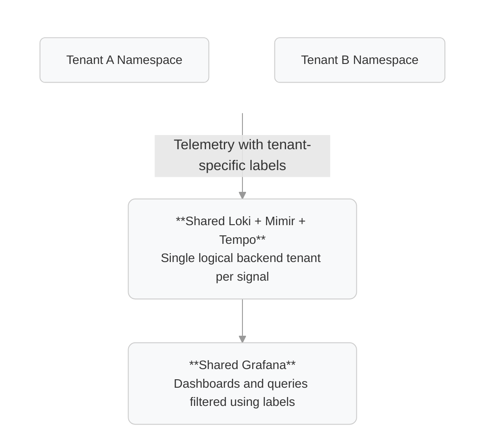
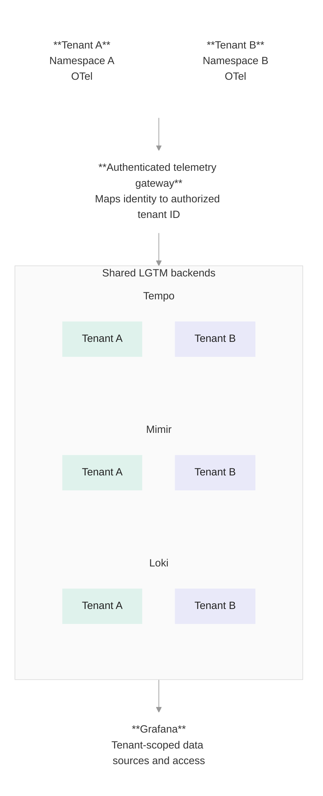

# Multi-tenant Grafana LGTM architecture

## Patterns

Primary architectural patterns worth considering.

**Option A: Shared LGTM, isolated using labels**
All tenants share the same backends, with tenant-specific labels such as `tenant_id`, and `namespace`.

<span style="color: gray;">
Simplest and cheapest, but labels alone do not provide a secure isolation boundary.
</span>

**Option B: Shared LGTM, native backend multi-tenancy**

Shared Loki, Mimir, and Tempo clusters, with each tenant assigned an isolated logical tenant ID.

<span style="color: gray;">
Often the best balance of operational efficiency, logical data isolation, and scalability.
</span>

**Option C: Dedicated LGTM deployments per tenant**
Each tenant gets separate Loki, Mimir, Tempo, and potentially Grafana deployments.
Stronger resource and operational isolation, with substantially more infrastructure to maintain.

**Option D: Hybrid multi-tenancy**
Shared ingestion and/or backends for most tenants, dedicated deployments for sensitive or high-volume tenants, and a central platform observability experience.
Useful when tenant security, compliance, or performance requirements vary.

## How LGTM handles native multi-tenancy

| Component | Native multi-tenancy mechanism | Important consideration |
|---|---|---|
| Loki (logs) | `X-Scope-OrgID` | Isolates tenant log ingestion and queries |
| Mimir (metrics) | `X-Scope-OrgID` | Isolates tenant metrics and supports tenant-specific limits |
| Tempo (traces) | `X-Scope-OrgID` | Isolates trace ingestion and querying |
| Grafana | Organizations, teams, folders, RBAC | Controls which users can access data sources, dashboards, and other resources |

The main difference is that Loki, Mimir, and Tempo use tenant IDs to separate data at the storage and query level, while Grafana manages who can access what through its own permissions system.

For example, you could have:

```text
tenant-a
  ├── Loki tenant: tenant-a
  ├── Mimir tenant: tenant-a
  └── Tempo tenant: tenant-a

tenant-b
  ├── Loki tenant: tenant-b
  ├── Mimir tenant: tenant-b
  └── Tempo tenant: tenant-b
```

Each backend receives an HTTP header such as:

```http
X-Scope-OrgID: tenant-a
```

This tells the backend which tenant's data is being written or queried. The backend keeps the data separated, but the header itself doesn't verify who's making the request. That's why a trusted gateway needs to authenticate clients and make sure they can only access the tenants they're allowed to.

## How each approach would look on your platform

### Option A: Shared LGTM with labels


Every telemetry item gets attributes identifying its origin:

```yaml
tenant_id: tenant-a
environment: production
k8s_namespace_name: tenant-a
gcp_project_id: tenant-a-prod
```

In Grafana, dashboards can query data filtered by `tenant_id`. 

We noted that labels alone are insufficient to establish a secure isolation boundary. This is because labels indicate which tenant the telemetry belongs to, but do not inherently determine who is authorized to access it.

Let's say `tenant-a` and `tenant-b` send metrics to the same Mimir tenant, with labels identifying their origin:

```promql
http_requests_total{
  tenant_id="tenant-a",
  namespace="tenant-a"
}
```

```promql
http_requests_total{
  tenant_id="tenant-b",
  namespace="tenant-b"
}
```

Now imagine customer A opens Grafana. You configure its dashboard to query:
```promql
http_requests_total{tenant_id="tenant-a"}
```
Everything looks correct. The dashboard only shows tenant A's metrics. But what prevents customer A from changing the query to:

```promql
http_requests_total{tenant_id="tenant-b"}
```

Or even:

```promql
http_requests_total
```promql

If its Grafana data source has unrestricted access to the shared Mimir tenant, both queries can succeed. The label `tenant_id` doesn't instruct Mimir to deny the request. It's simply a filter applied by the query. The same problem exists in Loki:

```logql
{tenant_id="tenant-a"}
```

A customer who can submit arbitrary LogQL queries could change that to:
```logql
{tenant_id="tenant-b"}
```
And in Tempo, a user with unrestricted access to the same backend tenant could search for another customer's traces or retrieve a trace by ID.

**One Last Thing:**

This approach is obviously cheaper and easier to manage. But the downside is that you don't get real tenant isolation, since users could potentially access data from other tenants.

A better way to handle this is with label-based access control (LBAC), which Grafana supports for certain data sources in Enterprise and Cloud environments. Instead of relying on dashboards to filter data, LBAC applies the filters directly when users run queries.

Option A with LBAC is a reasonable choice if your teams trust each other, the labels added by collectors are reliable, and you're using Grafana products that support LBAC. You can also handle noisy neighbors at the collector level to start with.

However, LBAC does not provide native backend-level tenant isolation, per-tenant ingestion and query quotas, or independent resource isolation. All teams still share the same backend resources, meaning one team's excessive telemetry volume or expensive queries could affect others. Additionally, LBAC only controls access to data during querying; it does not prevent ingestion impersonation or enforce tenant identity when telemetry is written. These protections would need to be implemented separately, for example through trusted collectors, ingestion controls, and resource management.

### Option B: Native LGTM multi-tenancy



If you manage the OTel collectors centrally in a platform-owned namespace, you will get a trusted place to enforce tenant identity which is a great thing to establish a multi-tenant LGTM setup. It also makes the option B way easier to implement securely.

In this setup, you would keep one shared deployment of Loki, Mimir, and Tempo; the collector receives telemetry from applications running in `team-a` and `team-b` namespaces. Using trusted Kubernetes metadata, it identifies which namespace each telemetry item belongs to and routes it to the appropriate LGTM tenant:

```text
Kubernetes Cluster
│
├── namespace: team-a ──┐
│                       │
├── namespace: team-b ──┤
│                       ▼
└── namespace: observability
       │
       └── OTel Collector
            │
            ├── team-a → X-Scope-OrgID: team-a
            └── team-b → X-Scope-OrgID: team-b
                        │
                        ▼
                Shared Loki/Mimir/Tempo
```

One important thing to keep in mind is that the central OTel Collector needs to know which LGTM tenant each telemetry item belongs to, and send it with the correct `X-Scope-OrgID` header. OpenTelemetry has a `headers_setter` extension that can help with this.

The `headers_setter` extension is an OpenTelemetry Collector component that lets you automatically set HTTP/gRPC headers when exporting telemetry to Loki, Mimir, or Tempo.

```text
team-a namespace ──┐
                   ├──► Central OTel Collector
team-b namespace ──┘      (platform namespace)
                               │
                        headers_setter
                               │
                    ┌──────────┴──────────┐
                    ▼                     ▼
           X-Scope-OrgID: team-a  X-Scope-OrgID: team-b
                    │                     │
                    └──────────┬──────────┘
                               ▼
                         Shared LGTM
```

With the central platform-managed OTel collectors, tenant identification and routing are handled in one place, without letting application teams set `X-Scope-OrgID` themselves.

You can also set ingestion limits per tenant in LGTM, so if `team-a` starts sending too much telemetry, you can limit it without affecting `team-b`.

> [!IMPORTANT]
> Tenants must not be able to access LGTM backends directly, bypassing your collector or gateway.

What if a tenant sends a fake `X-Scope-OrgID`?

If the OTel collect is configured correctly, the fake header should have no effect. The collector should: 
- Ignore or remove tenant-supplied X-Scope-OrgID headers.
- Determine the tenant from trusted Kubernetes metadata (e.g., namespace).
- Set the correct X-Scope-OrgID when exporting to LGTM.

**More on Option B**

A logical tenant ID is simply a unique identifier (a string) that Loki, Mimir, and Tempo use to separate one tenant's data from another's within the same shared backend.

For example:
```text
Tenant A → tenant-a-prod
Tenant B → tenant-b-prod
```

When sending or querying telemetry, you provide the tenant ID through an HTTP header:

```http
X-Scope-OrgID: tenant-a-prod
```

The backend uses that ID to determine which tenant's data to write or query.

The logical tenant ID itself provides no protection against impersonation. By default, Loki, Mimir, and Tempo trust the `X-Scope-OrgID` header.

Without additional security, Tenant A could send:

```http
X-Scope-OrgID: tenant-b
```

And potentially access Tenant B's telemetry. How do you prevent this? You put an authentication and authorization gateway in front of LGTM.

```text
Tenant A
   │
   │ Authenticated request
   ▼
Gateway
   │
   ├── 1. Authenticate Tenant A
   ├── 2. Resolve identity → tenant-a
   ├── 3. Remove any client-provided X-Scope-OrgID
   └── 4. Set X-Scope-OrgID: tenant-a
   │
   ▼
Loki / Mimir / Tempo
```

The gateway must derive the tenant ID from a trusted identity, such as a Kubernetes workload identity or validated credential, never from an untrusted HTTP header.

What actually guarantees isolation?
Two things together:
1. Gateway enforcement: Every request is authenticated and assigned only its authorized tenant ID.
2. Network isolation: Tenants cannot bypass the gateway and communicate directly with Loki, Mimir, or Tempo.

### Option C: Dedicated LGTM per tenant

```text
Tenant A
  ├── Namespace / GCP Project
  ├── Loki A
  ├── Mimir A
  ├── Tempo A
  └── Grafana A

Tenant B
  ├── Namespace / GCP Project
  ├── Loki B
  ├── Mimir B
  ├── Tempo B
  └── Grafana B
```

Another option is to keep Grafana centralized while giving each tenant its own dedicated LGTM backends.

This actually fits pretty well with the existing infrastructure setup, especially if each tenant already has its own GCP project. You could simply keep their observability storage and credentials in the same project.

The nice thing about this approach is that you get much stronger isolation. Each tenant can scale independently, have its own retention policies, and manage access through GCP IAM. Plus, if something goes wrong with one tenant's backend, it's less likely to affect the others.

Of course, this comes at a cost. Running separate backends means more infrastructure to pay for, more components to upgrade, and more things to maintain. Getting a single observability view across all tenants also becomes a bit more complicated.

One thing worth mentioning is that running dedicated LGTM backends in separate namespaces within the same Kubernetes cluster isn't quite the same as running them in separate clusters or GCP projects. You still share some underlying infrastructure.

So, this approach probably makes more sense when you really need that extra isolation, like for premium customers, regulated workloads, or tenants with strict security requirements.

#### Option D: Hybrid
Of course, there's always the option of a hybrid model. But as a platform team, we tend to lean toward standardization, simplification, with fewer custom setups and exceptions.

In this setup, for instance, most tenants use a shared multi-tenant LGTM backend, while sensitive tenants get dedicated Loki, Mimir, and Tempo deployments.

The most obvious value here is flexibility. As a platform team, you're trying to strike a balance between standardization and flexibility, but you need to be careful about the extra operational overhead and the additional routing and provisioning logic that comes with it.

## Grafana has its own multi-tenancy problem

Even after you isolate Loki, Mimir, and Tempo, you need to decide how tenant users access Grafana.

There might be three relevant choices:

| Grafana model | How it works | Isolation |
|---|---|---|
| Single organization with teams/folders | One shared Grafana organization with per-tenant resources | Weak unless paired with data-source controls |
| Organization per tenant | Each tenant has its own dashboards, users, teams, alerts, and data sources | Stronger UI-level separation |
| Grafana instance per tenant | Each tenant gets its own Grafana server and configuration | Strongest deployment separation |

Grafana OSS supports multiple organizations. They isolate organization resources, including dashboards and data sources, within a single Grafana instance. [¹](https://grafana.com/docs/grafana/latest/administration/organization-management/)

**Shared Loki/Mimir/Tempo + one Grafana organization per tenant.**

For example, Grafana organization A has Loki, Mimir, and Tempo data sources configured to access only tenant A's data, while organization B has the same setup for tenant B.

The nice thing about this approach is that each tenant gets its own Grafana experience without needing a separate Grafana deployment.

But keep in mind that all organizations still share the same Grafana server and some global settings, so it's not the same as having separate infrastructure.

One more thing worth mentioning is that, in Grafana OSS, folder permissions don't control access to data sources. If you need more fine-grained control over who can access which data sources, Grafana Enterprise and Cloud offer additional options.
