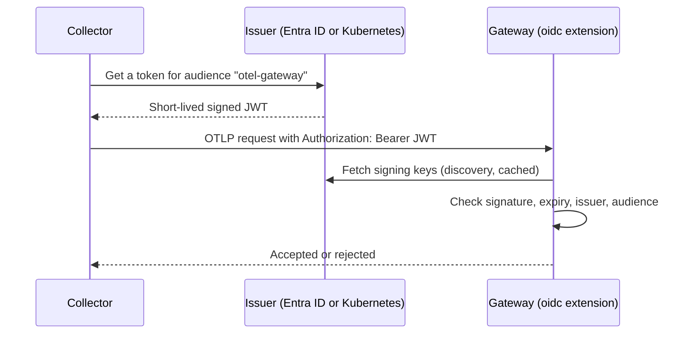

# Collector authentication

Collectors authenticate to the gateway with a bearer token in the `Authorization` header. The token is either a static secret shared by all collectors, or a signed short-lived JWT validated with the OIDC authenticator extension.

## Static shared bearer token

Every collector sends `Authorization: Bearer <token>`, and the gateway compares it with its own copy using the `bearertokenauth` extension.

Collector side:

```yaml
extensions:
  bearertokenauth/gateway:
    token: ${env:GATEWAY_TOKEN}

exporters:
  otlphttp/gateway:
    auth:
      authenticator: bearertokenauth/gateway
```

Gateway side:

```yaml
extensions:
  bearertokenauth:
    token: ${env:GATEWAY_TOKEN}

receivers:
  otlp:
    protocols:
      http:
        auth:
          authenticator: bearertokenauth
```

The token is one secret, stored in a secret store and delivered to the gateway and to every collector.

Properties:

- A request with the token is accepted and a request without it is rejected.
- All collectors use the same token, so the gateway cannot tell them apart.
- The token does not expire. Rotating it means changing the secret in every collector and the gateway.
- The gateway trusts the `tenant.id` set by the sender. Whoever holds the token can send telemetry for any tenant.

## OIDC authentication

[`oidcauthextension`](https://github.com/open-telemetry/opentelemetry-collector-contrib/tree/main/extension/oidcauthextension) (listed in the [OpenTelemetry registry](https://opentelemetry.io/ecosystem/registry/?s=authenticator&component=extension)) is a server-side authenticator. A receiver that sets `auth.authenticator: oidc` accepts a request only if it carries a valid JWT in the `Authorization: Bearer` header.

- Stability: beta. It is part of the contrib and k8s distributions, and the gateway's collector build must include it.
- It does not issue tokens. It only validates them.

For each request the extension:

1. Reads the `iss` claim and picks the configured provider with the same `issuer_url`. Without a match the request is rejected.
2. Gets the provider's public keys through OpenID Connect Discovery (cached, refreshed periodically), or from a local JWKS file if `public_keys_file` is set.
3. Verifies the signature, the expiry and that the token's `aud` matches the configured `audience`.
4. Makes the token's claims available to the pipeline (see "Authorization" below).



The gateway holds no secret. It only needs to reach the issuer's key endpoint, or have the key set as a file.

### Gateway configuration

```yaml
extensions:
  oidc:
    providers:
      - issuer_url: <issuer URL>
        audience: otel-gateway
        # issuer_ca_path: /path/to/ca.pem   # if the issuer uses a private CA

receivers:
  otlp:
    protocols:
      http:
        auth:
          authenticator: oidc

service:
  extensions: [oidc]
```

Several providers can be listed, so one gateway can trust more than one issuer, for example the management and the development cluster. A token is checked only against the provider whose `issuer_url` matches its `iss`.

### Where the tokens come from

The collectors need a token for the gateway's audience, refreshed before it expires. There are two realistic issuers.

#### Microsoft Entra ID

Register the gateway as an API and each collector (or each collector type) as a client. The collector uses the [`oauth2client`](https://github.com/open-telemetry/opentelemetry-collector-contrib/tree/main/extension/oauth2clientauthextension) extension, which gets and refreshes the token automatically:

```yaml
extensions:
  oauth2client:
    client_id: <collector app client id>
    client_secret_file: /etc/otel/client-secret
    token_url: https://login.microsoftonline.com/<tenant id>/oauth2/v2.0/token
    scopes: ["api://otel-gateway/.default"]

exporters:
  otlphttp/gateway:
    auth:
      authenticator: oauth2client
```

- Works from any cluster, so it suits the development to management path.
- Each collector still needs a credential (a client secret or a signing key, which the extension can reload from a file). It is per collector and rotatable, but it is still a secret. As far as its documentation shows, the extension does not support federated credentials.
- Entra must be configured so that only the collector apps can get a token for the gateway audience. Verify how to enforce this before relying on it.

#### Kubernetes ServiceAccount tokens

Each collector pod mounts a projected ServiceAccount token with the audience `otel-gateway`. The kubelet rotates it, so no secret is stored anywhere. The collector sends the file's contents as the bearer token (`bearertokenauth` can read the token from a file and pick up changes; confirm this on the collector version we run).

- The issuer is the cluster's API server, which signs the tokens. The gateway needs the cluster's issuer URL and its public signing keys (see "Trusting more than one cluster").
- Any pod can request a token with any audience for its own ServiceAccount. A valid token therefore proves only "some pod in that cluster". Restrict who is accepted as described next.

##### Trusting more than one cluster

When collectors run in several clusters, such as the management and the development cluster, the gateway needs the issuer and the signing keys of each one.

- **Each cluster needs its own issuer URL.** The extension chooses the provider by the token's `iss` claim, so two clusters with the same issuer cannot be told apart. Managed clusters such as GKE already have a unique, public issuer. kind clusters all default to `https://kubernetes.default.svc.cluster.local`, so each kind cluster needs its own `service-account-issuer` API server argument, for example `https://management.kind.local`. The URL does not have to resolve.
- **Clusters the gateway can reach** need only the `issuer_url`. The extension fetches the keys by OpenID Connect Discovery.
- **Clusters the gateway cannot reach**, such as kind clusters, provide their keys as a file. Export them with `kubectl --context <cluster> get --raw /openid/v1/jwks`, store them in a ConfigMap and mount it into the gateway. With `public_keys_file` set, discovery is off for that provider, so the gateway makes no network calls to the cluster. The file has to be regenerated when the cluster is recreated or its signing keys rotate.

```yaml
extensions:
  oidc:
    providers:
      - issuer_url: https://management.kind.local
        audience: otel-gateway
        public_keys_file: /etc/otel/jwks/management.json
      - issuer_url: https://development.kind.local
        audience: otel-gateway
        public_keys_file: /etc/otel/jwks/development.json
```

### Authorization

The extension only authenticates. The claims of a validated token are available in the pipeline, so the gateway can also decide who is allowed:

- `auth.claims.subject` and `auth.claims.<claim name>` can be copied into resource attributes with the `resource` processor (`from_context`) and then checked with a `filter` processor.
- For a ServiceAccount token the subject is `system:serviceaccount:<namespace>:<name>`. Accepting only subjects that start with `system:serviceaccount:observability:otel-` limits writes to the platform collectors, so a tenant pod with its own valid token is rejected.

A sketch (untested):

```yaml
processors:
  resource/caller:
    attributes:
      - key: caller.subject
        action: upsert
        from_context: auth.claims.subject
  filter/only_platform_collectors:
    error_mode: ignore
    metrics:
      metric:
        - 'not IsMatch(resource.attributes["caller.subject"], "^system:serviceaccount:observability:otel-")'
    # same for traces and logs
```

Place both processors before `partitioning`, and delete `caller.subject` before exporting. The same mechanism can restrict which collector may send which signal.
