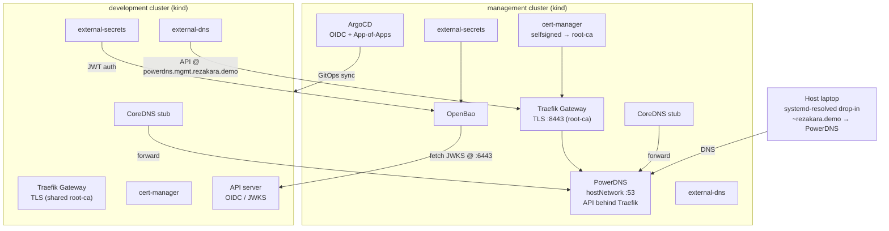

# Architecture & Design Decisions

This document captures the *why* behind the local kind environment. For setup and
usage see [README.md](README.md).

---

## Overview

Two kind clusters model a real platform:

- **management** — runs the platform control plane (ArgoCD, OpenBao, PowerDNS,
  cert-manager, external-secrets, Traefik).
- **development** — a tenant cluster whose platform components are installed by
  ArgoCD via GitOps.



---

## kind over minikube

kind is lighter and faster to tear down and recreate than minikube with a VM
driver. Both clusters run as Docker containers on a single `kind` bridge network,
so pods in one cluster can reach nodes in the other directly — no tunnels.

Cluster names are `management` and `development`; kube contexts are therefore
`kind-management` and `kind-development`.

---

## DNS without a laptop daemon

**Goal:** avoid installing a DNS daemon (dnsmasq) that reshapes the host's global
resolver config.

**Solution:** PowerDNS runs *inside* the management cluster with `hostNetwork:
true`, binding `:53` on the management node's Docker-bridge IP. Three consumers
reach it:

- **Host** — a two-line systemd-resolved drop-in
  (`/etc/systemd/resolved.conf.d/rezakara.demo.conf`) routes only `~rezakara.demo` to
  PowerDNS. Nothing else about the host resolver changes.
- **Management pods** — CoreDNS is patched with a stub zone forwarding
  `rezakara.demo` to the PowerDNS node IP.
- **Workload pods** — same CoreDNS stub, reaching PowerDNS across the kind bridge.

`hostNetwork` (rather than a Cilium LoadBalancer IP) is used because the node IP
is routable from pods in *both* clusters and from the host, whereas a Cilium LB IP
in the management cluster is not reachable from the development pod network.

### Why keep external-dns + PowerDNS

This mirrors the real cloud model: applications create Gateway API `HTTPRoute`s,
external-dns observes them and writes records into a DNS provider's API (PowerDNS
here, Cloud DNS in production). Keeping this loop locally exercises the same code
paths as production instead of a simplified hosts-file hack.

---

## TLS chain

cert-manager builds a local PKI:

```
selfsigned (ClusterIssuer)
  └── root-ca (Certificate, CA)
        └── root-ca (ClusterIssuer)
              └── *.mgmt.rezakara.demo (wildcard, issued to Traefik)
```

`baseline-management` provisions the `selfsigned` → `root-ca` chain. Traefik's
Gateway is annotated with `cert-manager.io/cluster-issuer: root-ca`, so
cert-manager mints the wildcard cert and Traefik terminates HTTPS on `:8443`.

The root CA is pushed to OpenBao (`kv/shared/pki/root-ca`) via an external-secrets
`PushSecret`. `setup-trust.sh` pulls it back out and installs it into the host's
Java, browser (NSS), and system trust stores, and seeds the `root-ca` secret into
the development cluster — so the **same** CA is trusted across host and both clusters.

---

## Secrets: OpenBao + external-secrets

OpenBao (KV v2 at mount `kv`) is the source of truth for all secrets. Bootstrap
scripts write secrets from `pass`; external-secrets materialises them into
Kubernetes as needed.

- The **management** cluster uses a `ClusterSecretStore` (`openbao-local`) that
  reaches OpenBao over its HTTPS route and authenticates via JWT auth.
- The **development** cluster uses a `SecretStore` and its own OpenBao JWT auth backend
  (`jwt-development`) configured by `setup-openbao.sh`.

OpenBao validates each pod's ServiceAccount token cryptographically: it fetches the
cluster's public signing keys (JWKS) from that cluster's issuer URL
(`https://api.<env>.k8s.rezakara.demo:6443/openid/v1/jwks`), like every other consumer.
No long-lived reviewer token is needed.

> **Operational note:** the local `bao` CLI version may differ from the server.
> All bootstrap scripts run `bao` commands *inside* the `openbao-0` pod
> (`kubectl exec`) to avoid client/server version-mismatch errors.

---

## GitOps model for the development cluster

Workload platform components (cert-manager, external-secrets, Traefik,
external-dns) are **not** installed imperatively — ArgoCD installs them by syncing
`argocd/local/development/`.

The flow:

1. `setup-secrets.sh` creates an `argocd-manager` ServiceAccount with a long-lived
   token in the development cluster and stores `server` + `token` in OpenBao.
2. `gitops-platform`'s `clusters-credential` ExternalSecret materialises the
   ArgoCD **cluster Secret** (pull model — ArgoCD connects out to the development API).
3. `gitops-platform`'s App-of-Apps (`platform-application-folder`) points at
   `argocd/local/development/` with `directory.recurse: true`.
4. ArgoCD reconciles those Applications, installing the development platform stack.

Because ArgoCD reads from **Git**, chart and Application changes must be committed
and pushed before they take effect.

### Why the development cluster needs no identity seed

OpenBao authenticates development pods with JWT auth, fetching the development cluster's
JWKS **directly from its API server** (`https://api.dev.k8s.rezakara.demo:6443`). Because the API
server is up the moment the kind cluster exists, `setup-openbao.sh` can configure
`jwt-development` immediately; nothing has to be pre-seeded on the development cluster.

This deliberately avoids the bootstrap cycle that arises if you instead expose the
JWKS through the development's own Traefik ingress:

```
Traefik Gateway needs a TLS cert
  → cert comes from external-secrets (SecretStore)
    → SecretStore needs OpenBao jwt-development auth
      → jwt-development needs the JWKS endpoint behind Traefik
        → back to the Gateway that isn't up yet
```

Fetching the JWKS from the API server sits *below* that stack, so the whole
development platform can be pure GitOps with no hand-planted identity seed. The only
thing bootstrapped imperatively is `setup-secrets.sh` registering the development
cluster with ArgoCD (storing its API server + token in OpenBao).

### Shared cluster CA

Both kind clusters are created with the same cluster CA (`kind-configs/.crt/ca.{crt,key}`,
generated once by `setup-clusters.sh` and mounted into each control-plane node, where kubeadm
reuses it). Any pod's default `/var/run/secrets/kubernetes.io/serviceaccount/ca.crt` therefore
trusts the other cluster's API server, so a workload can read the other cluster's
`/openid/v1/jwks` live, with no copied keys or extra truststore. Kafka's external listener does this
to validate development tokens.

The ServiceAccount signing keys (`sa.key`) stay per cluster, so each cluster keeps its own issuer.
The shared CA key can mint certificates trusted by both clusters; that is acceptable for a local lab only.

### ServiceAccount issuers and key discovery

Each cluster signs its ServiceAccount tokens with its own key and puts its own issuer in the `iss` claim.
The issuers differ on purpose: a consumer that trusts more than one cluster picks the provider by `iss`,
so two clusters with the same issuer cannot be told apart.

| Cluster | API server name = issuer (`iss`) | Set in |
|---|---|---|
| management | `https://api.mgmt.k8s.rezakara.demo:6443` | `kind-configs/management.yaml`, `MANAGEMENT_SA_ISSUER` in `libs/common.sh` |
| development | `https://api.dev.k8s.rezakara.demo:6443` | `kind-configs/development.yaml`, `DEVELOPMENT_SA_ISSUER` in `libs/common.sh` |

Every issuer is a URL that serves its own OIDC discovery document
(`<issuer>/.well-known/openid-configuration`), whose `issuer` equals that URL. That is why each issuer is the
API server's own name and not an arbitrary string. The name is added to the API server cert (`certSANs`) and
set as `service-account-jwks-uri` when the cluster is created. Docker assigns the node IPs, so
`setup-clusters.sh` points both names at them in both clusters' CoreDNS (`hosts` block for `rezakara.demo`)
once the clusters are up, which keeps the issuers stable whatever IPs the nodes get. `api-audiences` is set to
the kubeadm default (`https://kubernetes.default.svc.cluster.local`) on both clusters, so OpenBao and ESO
audiences do not change.

No signing key is copied anywhere. Whoever validates a token reads the keys live from the issuing API server,
and trusts it through the shared cluster CA (a pod's default service account CA):

| Consumer | Validates | Keys fetched from |
|---|---|---|
| Kafka `tls` listener | management | `https://api.mgmt.k8s.rezakara.demo:6443/openid/v1/jwks` |
| Kafka `external` listener | development | `https://api.dev.k8s.rezakara.demo:6443/openid/v1/jwks` |
| SeaweedFS STS | management | `https://api.mgmt.k8s.rezakara.demo:6443/openid/v1/jwks` |
| otel-gateway (`oidc` extension) | management and development | discovery at each issuer URL |
| OpenBao `jwt-management`, `jwt-development`, `jwt-development-tenants` | management / development | `https://api.mgmt.k8s.rezakara.demo:6443/openid/v1/jwks` / `https://api.dev.k8s.rezakara.demo:6443/openid/v1/jwks` |

OpenBao must not depend on the Gateway (see "Why the development cluster needs no identity seed"). The
API server names resolve through CoreDNS `hosts` entries, which need neither the Gateway nor PowerDNS. Both API servers allow anonymous reads
of the discovery endpoints (`system:service-account-issuer-discovery` bound to `system:unauthenticated`,
done by `setup-openbao.sh`). Consumers that fetch keys at startup should tolerate the API server not being
ready yet; Kafka sets `oauth.fail.fast="false"` for this.

### PowerDNS API at a stable hostname

Workload external-dns must reach the management PowerDNS API. The management node
IP changes when kind clusters are recreated, and ArgoCD applies static YAML from
Git, so it cannot inject a runtime IP.

Instead the PowerDNS API is exposed behind the management Traefik at a stable
hostname (`powerdns.mgmt.rezakara.demo`). Workload external-dns targets that URL
with `--pdns-skip-tls-verify` (local self-signed CA). This keeps the whole development
stack in GitOps and portable across cluster recreation — and mirrors the cloud
model of talking to a DNS API over a stable endpoint.

---

## ArgoCD authentication

ArgoCD runs with Azure AD OIDC enabled (same config as the cloud/minikube setup),
with the local `admin` account retained as a fallback. The Azure client secret is
read from OpenBao into `argocd-secret` by an external-secrets `ExternalSecret`.
Because OIDC requires a working HTTPS URL, this depends on the TLS chain being up.

---

## Networking summary

| Concern | Mechanism |
|---------|-----------|
| LoadBalancer IPs | Cilium (L2 announcements), pools carved from the kind bridge CIDR |
| Cross-cluster reachability | shared `kind` Docker bridge network |
| DNS (host) | systemd-resolved drop-in → PowerDNS node IP |
| DNS (pods) | CoreDNS stub zone → PowerDNS node IP |
| Ingress | Traefik + Gateway API, TLS via root-ca |
| Record automation | external-dns → PowerDNS API |
